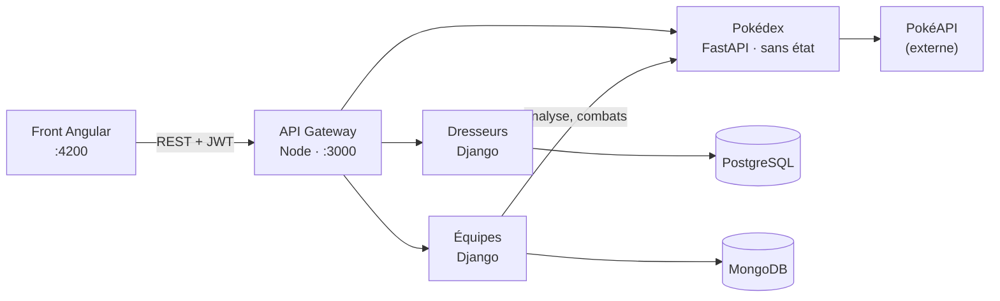

# PokéTeam — Pocket'APP en microservices

Application de création d'équipes Pokémon, avec analyse des faiblesses, affrontements animés
entre équipes, un mode Capture, des donjons et un boss final. Projet de cours : **migration d'un monolithe NestJS
vers une architecture microservices**.

| Contrainte du sujet | Réalisation |
|---|---|
| 1 front | Angular 19 + Bootstrap 5 (le front existant, conservé et corrigé) |
| 3 microservices | **Dresseurs** (Django), **Équipes** (Django), **Pokédex** (FastAPI) |
| 2 bases de données | **PostgreSQL** (Dresseurs), **MongoDB** (Équipes) |
| + | Une **API Gateway** (Node/Express), composant d'infrastructure |



Seule la gateway est exposée. Les services et les bases ne sont joignables que sur le réseau
Docker interne.

## Les dépôts

Chaque composant a **son propre dépôt** dans l'organisation GitHub
[poketeam-luco7](https://github.com/poketeam-luco7), avec ses tests et sa CI (GitHub Actions) :

| Dépôt | Composant | Stack |
|---|---|---|
| [`poketeam`](https://github.com/poketeam-luco7/poketeam) | **Orchestration** (ce dépôt) : `docker-compose.yml`, docs, ADR | Docker Compose |
| [`poketeam-front`](https://github.com/poketeam-luco7/poketeam-front) | Front | Angular 19 |
| [`poketeam-gateway`](https://github.com/poketeam-luco7/poketeam-gateway) | API Gateway | Node 22, Express 5 |
| [`poketeam-dresseurs`](https://github.com/poketeam-luco7/poketeam-dresseurs) | Microservice Dresseurs | Django + PostgreSQL |
| [`poketeam-equipes`](https://github.com/poketeam-luco7/poketeam-equipes) | Microservice Équipes | Django + MongoDB |
| [`poketeam-pokedex`](https://github.com/poketeam-luco7/poketeam-pokedex) | Microservice Pokédex | FastAPI, sans état |

Pourquoi ce découpage : [ADR 0017](docs/adr/0017-un-depot-par-composant.md).

📐 Architecture détaillée (C4, flux, données) : [`docs/architecture.md`](docs/architecture.md)
🧭 Décisions d'architecture (ADR) : [`docs/adr/`](docs/adr/README.md)

---

## Fonctionnalités

- **Comptes** : inscription, connexion (JWT), profil avec avatar.
- **Création d'équipes** : 1 à 6 Pokémon **capturés en mode Capture**, parmi les 9 générations, les **Méga-Évolutions** et les
  **formes alternatives** (Giratina-Origine, Motisma, formes régionales, Arceus par type…).
  Filtre par type toutes générations confondues, recherche par nom. Les Pokémon pas encore
  capturés apparaissent en silhouette.
- **Analyse en direct** pendant la création : grille des 18 types (faiblesses non couvertes,
  résistances), suggestions de types à ajouter.
- **Règles officielles** vérifiées côté serveur : un seul exemplaire par espèce
  (*Species Clause*), une seule Méga-Évolution par équipe.
- **Versus** : affrontement entre deux équipes (les tiennes ou les équipes publiques des autres
  dresseurs), avec une mise en scène animée et le détail du calcul.
- **Donjons** : les légendaires, les fabuleux et les Méga ne se capturent pas en run, ils ont
  chacun leur donjon. Le mode s'ouvre à **25 Pokémon capturés** ; pour entrer, le total des
  stats de l'équipe doit valoir **3 fois** celles du Pokémon, qui combat avec ses stats **× 4**.
  Le donjon d'une Méga apparaît quand on possède l'espèce qui méga-évolue.
- **Boss final** : **Éthernatos Infinimax** (1 125 de stats, × 4 en combat), objectif de fin de
  jeu, réservé aux équipes d'au moins 3 375 de stats.
- **Mode Capture** : on commence avec un seul starter (parmi les 27 des 9 générations) et on
  débloque les autres en combattant. Les Pokémon sauvages sont répartis en **paliers de 50 en
  stats de base** ; une run = 3 combats d'affilée contre des adversaires choisis parmi 3 tirés au
  hasard. Gagner les 3 permet de capturer le **premier stade** de la ligne d'un Pokémon battu.
  Les évolutions se gagnent au combat : **10 victoires** pour la 1re, **30** pour la 2e, choix de
  la branche pour Évoli et consorts, **50 victoires** avec la forme finale pour ses Méga.
  On choisit d'abord le palier, puis l'équipe, qui reste figée jusqu'à la capture ou la
  défaite. Un palier dont on possède toutes les lignes devient un **entraînement** : les
  victoires comptent pour les évolutions, sans capture à la clé, et un Pokémon ne peut pas s'y
  entraîner **2 paliers ou plus sous le sien**. Pour capturer, on entre dans le palier de son choix.
- **Pokédex du dresseur** : Pokémon capturés sur 1 025, par génération, et Méga-Évolutions.
  Les Pokémon débloqués sont les seuls utilisables partout : une équipe créée avant ce contrôle
  et contenant un Pokémon non capturé est marquée verrouillée et ne peut plus combattre.

## Lancer le projet

### Prérequis

- **Docker** avec Docker Compose v2 (Docker Desktop, ou [Colima](https://github.com/abiosoft/colima)
  sur Mac : `colima start --cpu 2 --memory 4`)
- **Node.js 20+** pour le front
- Un accès internet (le Pokédex interroge PokéAPI)

### 1. Récupérer les dépôts

Les dépôts doivent être **côte à côte** : `docker-compose.yml` construit les images depuis
`../poketeam-gateway`, `../poketeam-pokedex`…

```bash
mkdir poketeam-workspace && cd poketeam-workspace
git clone https://github.com/poketeam-luco7/poketeam.git
cd poketeam
./scripts/clone-all.sh     # clone (ou met à jour) les 5 autres dépôts à côté
```

### 2. Créer le fichier `.env` (secrets, jamais commité)

```bash
printf "JWT_SECRET=%s\nDJANGO_SECRET_KEY=%s\n" "$(openssl rand -hex 32)" "$(openssl rand -hex 32)" > .env
```

### 3. Démarrer le backend

```bash
docker compose up -d --build
docker compose ps        # 6 conteneurs « Up », seule la gateway expose le port 3000
```

### 4. Démarrer le front

```bash
cd ../poketeam-front
npm install
npx ng serve
```

Ouvrir **http://localhost:4200**, créer un compte depuis la page d'accueil puis se connecter.

> Le premier chargement d'une génération prend quelques secondes (le Pokédex remplit son
> cache depuis PokéAPI), les suivants sont instantanés.

## Organisation des dossiers

```
poketeam-workspace/
├── poketeam/                  # orchestration (ce dépôt)
│   ├── docker-compose.yml     # gateway, 3 services, 2 bases
│   ├── .env.example           # variables à définir dans .env
│   ├── scripts/clone-all.sh   # récupère les autres dépôts
│   └── docs/
│       ├── architecture.md    # schémas C4, flux, modèles de données
│       └── adr/               # Architecture Decision Records
├── poketeam-front/            # Angular 19 (front existant du monolithe)
├── poketeam-gateway/          # Node/Express : routage, JWT, CORS
├── poketeam-dresseurs/        # Django + DRF + PostgreSQL : comptes, authentification
├── poketeam-equipes/          # Django + DRF + pymongo + MongoDB : équipes, versus, capture, donjons
└── poketeam-pokedex/          # FastAPI, sans état : façade PokéAPI, règles et calculs Pokémon
    ├── app/data/capture.json  # référentiel du mode Capture (espèces, évolutions, stats)
    └── scripts/               # génération de ce référentiel depuis les CSV de PokéAPI
```

## API (via la gateway, `http://localhost:3000`)

Les routes conservent le contrat du monolithe d'origine (`/auth/login`, `/users`, `/teams`,
`/pokeapi/...`) : le front n'a pas eu à changer ses URL (cf. [ADR 0001](docs/adr/0001-migration-strangler-fig.md)).

| Méthode | Route | Auth | Service | Rôle |
|---|---|:-:|---|---|
| POST | `/users` | – | Dresseurs | Inscription |
| POST | `/auth/login` | – | Dresseurs | Connexion, renvoie `{ accessToken, user }` |
| GET | `/auth/profile` | ✔ | Dresseurs | Mon profil |
| PUT | `/users` | ✔ | Dresseurs | Modifier mon profil |
| GET | `/teams` | ✔ | Équipes → Pokédex | Mes équipes (avec `locked` : Pokémon non capturés) |
| POST | `/teams` | ✔ | Équipes → Pokédex | Créer une équipe (`nom`, `poke1`…`poke6`, `isPublic`), Pokémon capturés uniquement |
| GET · PUT · DELETE | `/teams/:id` | ✔ | Équipes | Lire, modifier, supprimer (propriétaire) |
| GET | `/teams/public` | ✔ | Équipes | Équipes publiques |
| POST | `/teams/:a/versus/:b` | ✔ | Équipes → Pokédex | Affrontement |
| POST | `/teams/:id/boss` | ✔ | Équipes → Pokédex | Combat contre le boss final |
| GET | `/pokeapi/generation/:n` | – | Pokédex | Pokémon d'une génération (1 à 9) et leurs formes |
| GET | `/pokeapi/megas` | – | Pokédex | Méga-Évolutions |
| GET | `/pokeapi/type/:type/pokemon` | – | Pokédex | Pokémon d'un type, toutes générations |
| GET | `/pokeapi/poke/:id` | – | Pokédex | Profil (stats, types, faiblesses, résistances) |
| GET | `/pokeapi/boss` | – | Pokédex | Boss final (Éthernatos Infinimax) |
| GET | `/dungeons` | ✔ | Équipes → Pokédex | Donjons visibles, ouverture du mode, boss final |
| POST | `/dungeons/:id/fight` | ✔ | Équipes → Pokédex | Entrer dans un donjon avec une équipe (`teamId`) |
| GET | `/capture` | ✔ | Équipes → Pokédex | Ma progression (collection, Pokédex, paliers, évolutions) |
| POST | `/capture/start` | ✔ | Équipes | Choisir son starter |
| POST · DELETE | `/capture/run` | ✔ | Équipes → Pokédex | Lancer une run ou un entraînement (`tier`, `pokemonIds` : équipe de la run) ou l'abandonner |
| POST | `/capture/run/fight` | ✔ | Équipes → Pokédex | Combattre un des adversaires proposés |
| POST | `/capture/run/reward` | ✔ | Équipes | Capturer un Pokémon battu (son premier stade) |
| POST | `/capture/evolution` | ✔ | Équipes → Pokédex | Choisir une branche d'évolution |
| POST | `/pokeapi/teams/analyze` | ✔ | Pokédex | Analyse d'une équipe en cours de création |

La documentation interactive du Pokédex (Swagger) est générée par FastAPI ; pour la consulter
en développement, exposer temporairement le port 8000 du service `pokedex`.

## Tests

**97 tests automatisés**, chacun dans le dépôt de son composant. Ils tournent à chaque push
dans **GitHub Actions** (onglet *Actions* de chaque dépôt), avec un vrai PostgreSQL ou MongoDB
pour les services qui en ont un. Le front est vérifié par un build.

| Dépôt | Tests | En local, depuis `poketeam/` |
|---|---|---|
| `poketeam-pokedex` | 50 : types, formule, mode Capture, donjons, boss final, façade PokéAPI simulée | `docker run --rm -v "$PWD/../poketeam-pokedex":/app -w /app python:3.12-slim sh -c "pip install -q -r requirements.txt pytest && python -m pytest -v"` |
| `poketeam-dresseurs` | 7, contre la vraie base PostgreSQL | `docker compose run --rm dresseurs python manage.py test` |
| `poketeam-equipes` | 31, contre la vraie base MongoDB (Pokédex simulé) | `docker compose run --rm equipes python manage.py test` |
| `poketeam-gateway` | 9 : JWT, usurpation d'identité, routage, CORS, service arrêté | `docker run --rm -v "$PWD/../poketeam-gateway":/app -w /app node:22-alpine sh -c "npm ci --silent && npm test"` |

## La formule d'affrontement

1. Chaque Pokémon ajoute **+1** dans chacune de ses faiblesses (multiplicateur > 1) et de ses
   résistances (< 1, immunités comprises). Les doubles types se **multiplient** :
   Eau/Sol est immunisé à Électrik (×2 × ×0).
2. **Score défensif** d'une équipe : somme, sur les types présents en face, de
   `résistances − faiblesses`.
3. **Avantage de type** = score défensif de l'équipe − score défensif de l'adversaire.
4. **Score final** = total des stats de base × `clamp(1 + 0,1 × avantage, 0,5, 1,5)`.

Détails et justification : [ADR 0009](docs/adr/0009-formule-affrontement.md).

## Sécurité

- Mots de passe **hachés** (PBKDF2, 870 000 itérations) ; le monolithe les stockait en clair.
- **JWT vérifié par la gateway**, qui transmet l'identité aux services (`X-User-Id`) après avoir
  supprimé tout en-tête du même nom envoyé par le client.
- Services et bases **non exposés** : seule la gateway est joignable.
- **Autorisation dans les services** : on ne peut lire, modifier, supprimer ou envoyer au
  combat que ses propres équipes (ou les équipes publiques pour le versus).
- Secrets dans `.env`, hors du dépôt.

## Limites connues

- Le Pokédex dépend de PokéAPI : si elle est indisponible et que le cache est vide, on ne peut
  plus créer d'équipe (les équipes existantes restent lisibles grâce aux instantanés).
- Le cache du Pokédex est en mémoire : il est vidé à chaque redémarrage.
- Les Méga-Évolutions et certaines formes (Darumacho Transe…) n'existent en jeu que pendant un
  combat ; ici on les choisit directement dans l'équipe, par simplification.
- La fiche détail d'un Pokémon interroge encore PokéAPI directement depuis le front
  (sprites shiny, attaques).
- L'équipe en cours de création est conservée pendant la navigation, mais pas après un
  rechargement complet de la page.
