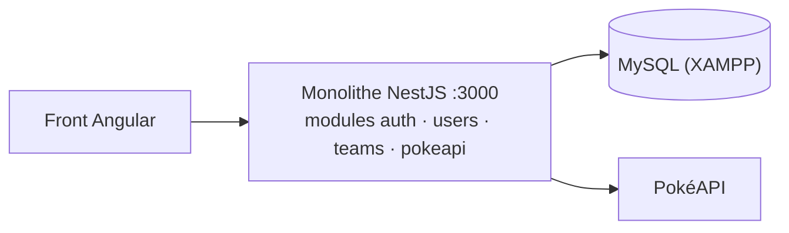
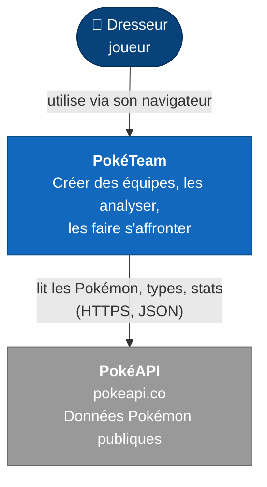
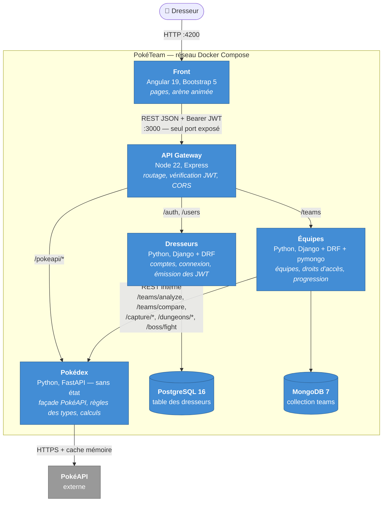
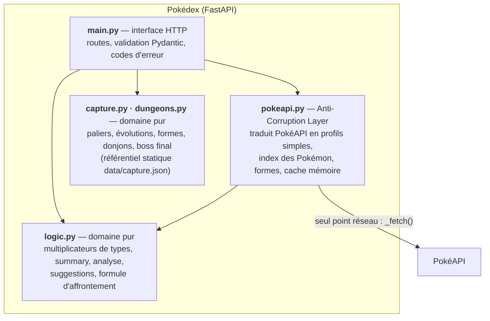
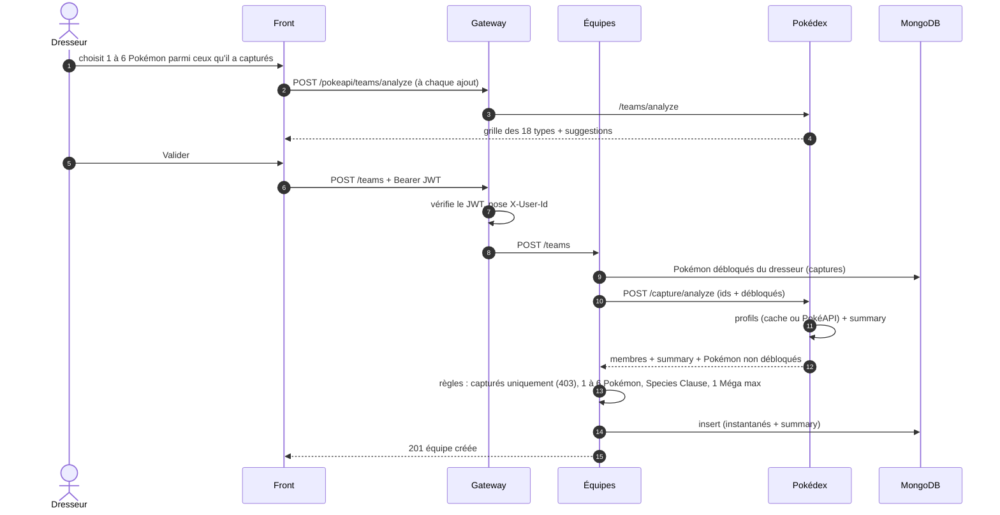
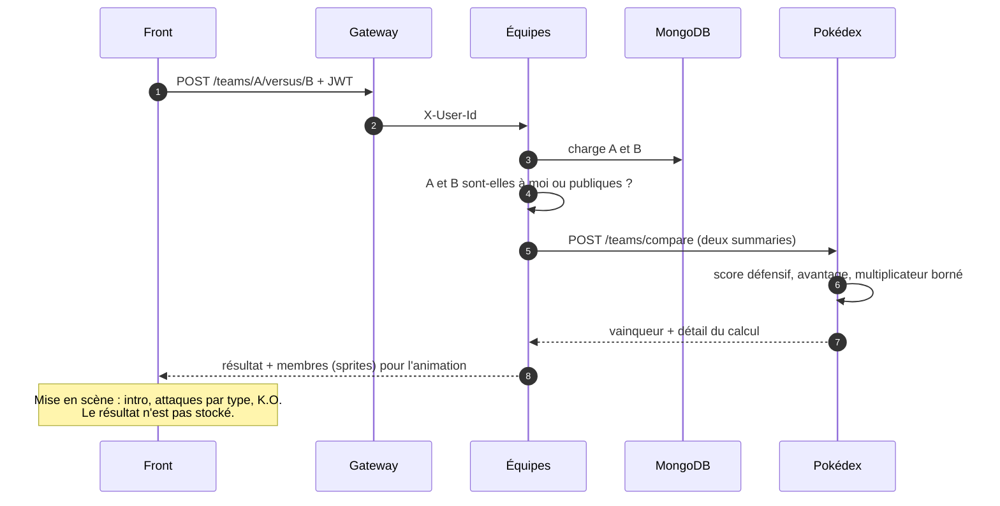
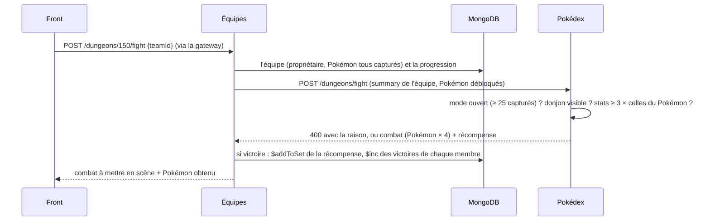
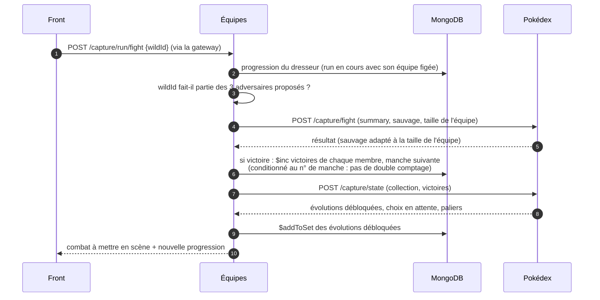
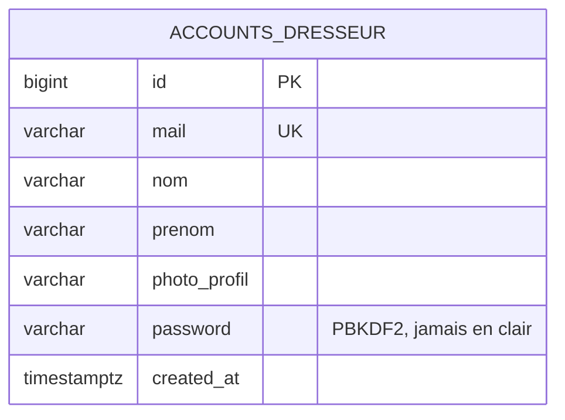
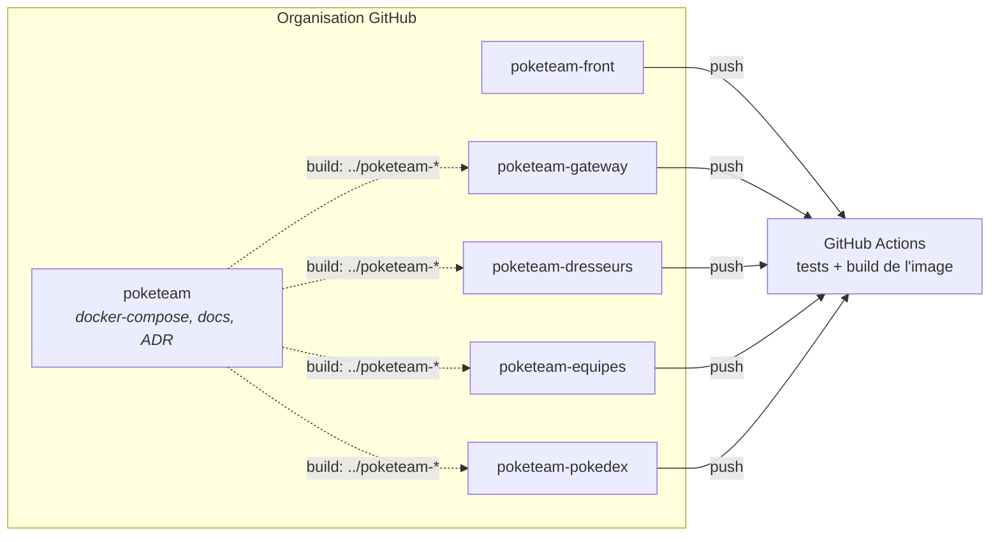

# Architecture de PokéTeam

Ce document décrit l'architecture selon le modèle **C4** (contexte, conteneurs, composants),
puis les flux principaux et les modèles de données. Les choix sont justifiés dans les
[ADR](adr/README.md).

---

## Point de départ : le monolithe

Le projet est la **migration** d'une application existante, *Pocket'APP* :



Problèmes relevés dans le monolithe, corrigés par la migration :

| Problème | Correction |
|---|---|
| Mots de passe stockés en clair | Hachage PBKDF2 dans Dresseurs |
| `GET /users/:mail` public, renvoyait le mot de passe | Route supprimée |
| `PUT /users`, `DELETE /users/:id`, `DELETE /teams/:id` sans contrôle d'accès | Identité via JWT, vérification du propriétaire |
| Secret JWT en dur dans le code | Variable d'environnement (`.env`) |
| ~150 appels successifs à PokéAPI pour lister une génération | 19 appels parallèles mis en cache (1,37 s → 0,025 s au 2ᵉ appel) |
| Boucle qui sautait des Pokémon dans la liste d'une génération | Réécrite dans le Pokédex, testée |

---

## Niveau 1 — Contexte



---

## Niveau 2 — Conteneurs



| Conteneur | Responsabilité | Ne fait **pas** |
|---|---|---|
| Gateway | Point d'entrée unique, **authentification** (qui es-tu ?), CORS | Aucune règle métier |
| Dresseurs | Identité : comptes, mots de passe hachés, émission des JWT | Vérifier les JWT (c'est la gateway) |
| Équipes | Ce que possède le dresseur : équipes, **autorisation** (est-ce ton équipe ?), persistance | Aucune règle de type Pokémon |
| Pokédex | Toute la connaissance Pokémon : données, types, faiblesses, analyse, formule de combat, capture, donjons, boss final | Aucun stockage, aucune notion d'utilisateur |

---

## Niveau 3 — Composants du Pokédex

Le service central du domaine est découpé en trois couches.



- `logic.py` n'a **aucune dépendance réseau** : il est testé avec des données en dur.
- `pokeapi.py` est le **seul** fichier qui connaît le format de PokéAPI ; ses tests remplacent
  `_fetch()` par une fausse PokéAPI.

---

## Flux principaux

### Création d'une équipe



### Affrontement (versus)



### Donjons et boss final



Le boss final suit le même chemin (`POST /teams/:id/boss` puis `/boss/fight`) avec un seul
Pokémon fixe, Éthernatos Infinimax ; une victoire est enregistrée dans la progression
([ADR 0019](adr/0019-donjons-et-boss-final.md)).

---

### Mode Capture : un combat de run



L'équipe de la run est composée au lancement (`POST /capture/run {tier, pokemonIds}`) :
Équipes la fait analyser par le Pokédex (`/capture/analyze`, qui refuse les Pokémon non
débloqués), puis stocke ses instantanés et son summary dans la run. Elle reste figée jusqu'à la
capture ou la défaite, et chaque combat n'a plus besoin de la réanalyser.

### Les Pokémon capturés, droit d'utilisation partout

La même vérification (`/capture/analyze`, cf. création d'équipe) protège la création et la
modification d'équipe. Pour le versus et le boss, Équipes appelle `POST /capture/locked` avec
chaque équipe et les Pokémon débloqués de **son** dresseur : une équipe créée avant ce contrôle
et contenant un Pokémon non capturé est refusée (409). Les listes d'équipes portent le même
calcul dans un champ `locked` ([ADR 0016](adr/0016-pokemon-debloques-droit-utilisation.md)).

## Modèles de données

### PostgreSQL — Dresseurs



### MongoDB — Équipes (collection `teams`)

Une équipe est un **agrégat** lu et écrit d'un seul bloc ; elle embarque un instantané de
chaque Pokémon et son summary pré-calculé.

```json
{
  "_id": "6710a3…",
  "userId": "1",
  "nom": "Team Eau",
  "isPublic": true,
  "members": [
    {
      "pokemonId": 9, "name": "blastoise", "isMega": false, "isForm": false,
      "sprite": "https://…/9.png", "types": ["water"],
      "stats": { "hp": 79, "attack": 83, "defense": 100, "spAtk": 85, "spDef": 105, "speed": 78 },
      "statTotal": 530,
      "weaknesses": ["electric", "grass"],
      "resistances": ["fire", "water", "ice", "steel"]
    }
  ],
  "summary": {
    "statTotal": 1605,
    "weak": { "electric": 3, "grass": 2 },
    "resist": { "fire": 2, "water": 3, "ice": 2, "steel": 2 },
    "offensiveTypes": ["water", "ice", "flying"]
  }
}
```

### MongoDB — progression du mode Capture (collection `captures`)

Un document par dresseur. Les règles (seuils, rencontres) sont dans le Pokédex ; Équipes ne
fait que stocker et appliquer, par des opérations atomiques.

```json
{
  "userId": "1",
  "starter": 4,
  "unlocked": [4, 5, 174, 746],
  "victories": { "charmander": 12, "charmeleon": 3 },
  "run": {
    "tier": 3, "round": 2, "reward": false,
    "team": [{ "pokemonId": 5, "name": "charmeleon", "baseSpecies": "charmeleon", "...": "instantané" }],
    "summary": { "statTotal": 405, "weak": {}, "resist": {}, "offensiveTypes": ["fire"] },
    "candidates": [{ "id": 191, "name": "sunkern", "statTotal": 180, "firstStage": { "id": 191 } }],
    "defeated":   [{ "id": 298, "name": "azurill", "firstStage": { "id": 298 } }]
  },
  "choices": []
}
```

Il n'y a plus de clé étrangère entre dresseurs et équipes : `userId` est une simple valeur
fournie par la gateway ([ADR 0004](adr/0004-persistance-polyglotte.md)).

---

## Déploiement (Docker Compose)

| Conteneur | Image | Port exposé à l'hôte | Dépend de |
|---|---|---|---|
| gateway | `node:22-alpine` | **3000** | dresseurs, equipes, pokedex |
| dresseurs | `python:3.12-slim` + gunicorn | – (8001 interne) | postgres (healthcheck) |
| equipes | `python:3.12-slim` + gunicorn | – (8002 interne) | mongo, pokedex |
| pokedex | `python:3.12-slim` + uvicorn | – (8000 interne) | PokéAPI (internet) |
| postgres | `postgres:16-alpine` | – | volume `pg_data` |
| mongo | `mongo:7` | – | volume `mongo_data` |

Les secrets (`JWT_SECRET`, `DJANGO_SECRET_KEY`) viennent du fichier `.env`. `JWT_SECRET` est le
seul secret partagé : Dresseurs **signe** les tokens, la gateway les **vérifie**.

### Un dépôt par composant

Chaque conteneur applicatif a son dépôt, sa CI et son cycle de vie ; le dépôt `poketeam` ne
contient que l'orchestration et la documentation
([ADR 0017](adr/0017-un-depot-par-composant.md)).



Les contrats entre dépôts sont les API REST (routes de la gateway, routes internes du
Pokédex) : un service peut évoluer et être testé seul tant qu'il respecte son contrat, ce que
vérifient ses tests (les autres services y sont simulés).
